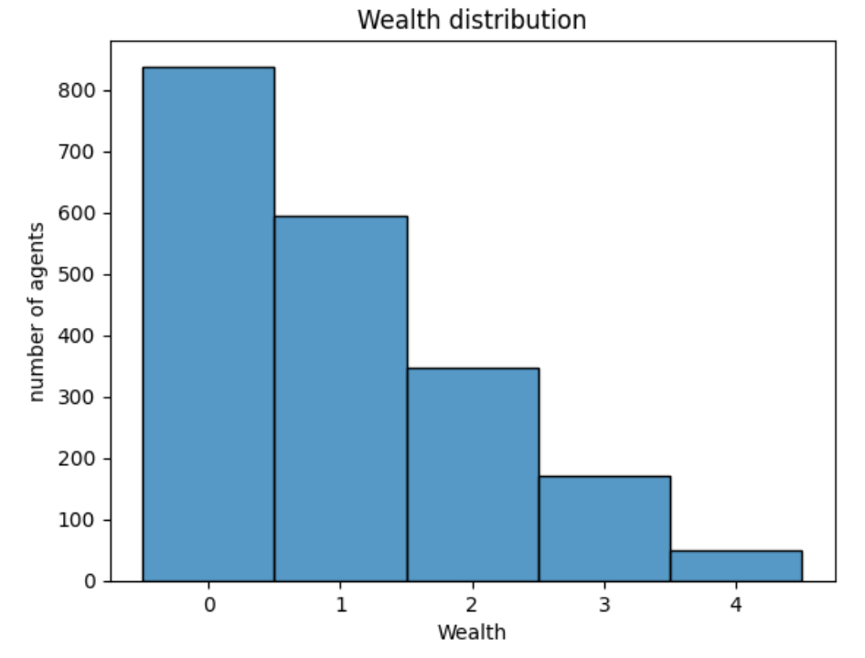
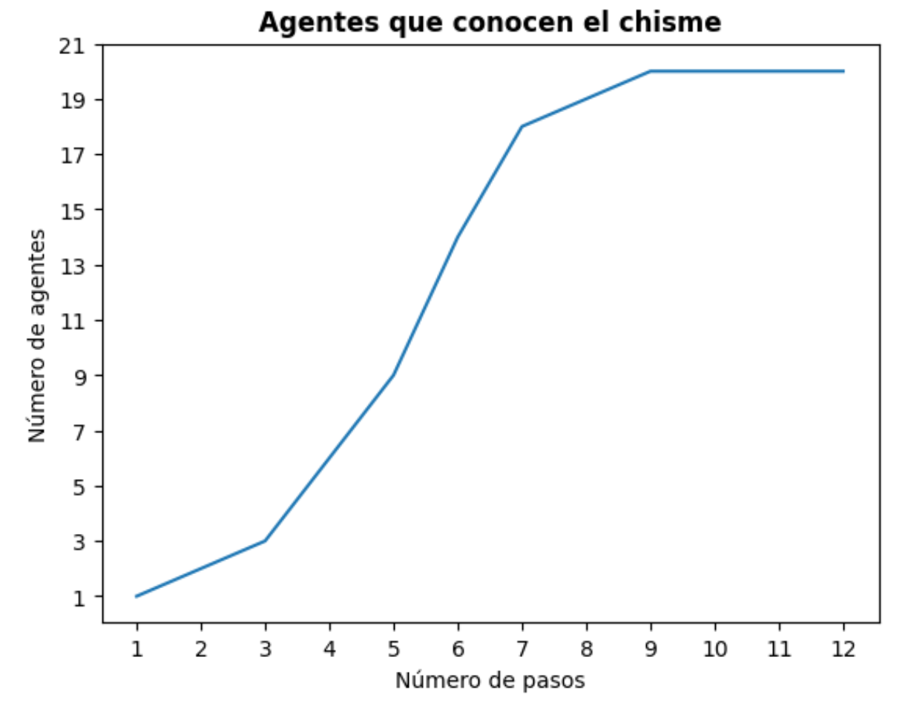

# Inteligencia Artificial: Representación y Solución de Problemas

## Taller 3

*Profesor: Nicolás Avilán Vargas, Ph.D.*

1. Modifique el código trabajado en clase para describir una dinámica semejante, restringiendo al caso en el que un agente pueda tener máximo cuatro monedas. Grafique el resultado de repetir 100 veces el experimento, considerando 20 agentes y 20 pasos. Debería obtener una gráfica como la siguiente:

   

   Observe que, aunque hay un máximo de cuatro monedas de riqueza por agente, se mantiene el comportamiento de tener pocos agentes con alta riqueza y muchos con poca.

2. Proponga e implemente una modificación adicional al código para simular una nueva dinámica. Explique e ilustre sus resultados con gráficas.

3. Modifique el código del Modelo Basado en Agentes que trabajamos en clase para describir la dinámica de la propagación de un chisme. El valor 1 en `wealth` significa que el agente conoce el chisme, mientras que el valor 0 indica que no lo conoce. Haga que, de manera aleatoria, solo el 10 % de los agentes conozcan inicialmente el chisme. Explique la implementación de esta condición inicial.

   Modifique también la interacción del agente de tal forma que se exija que `wealth` sea 1 para buscar otro agente, e imponga que el agente encontrado quede con `wealth = 1`. Realice un experimento con 20 agentes dando 12 pasos. Registre cuántos agentes conocen el chisme en cada paso y grafique el resultado. Debería observar una gráfica similar a esta:

   

   Recuerde que, por la naturaleza estocástica de la simulación, no tendrá exactamente el mismo resultado en cada ejecución.

**Envío:** Subir a la plataforma un único archivo con extensión `.ipynb` con la solución del taller, incluyendo códigos, gráficas y respuestas.
